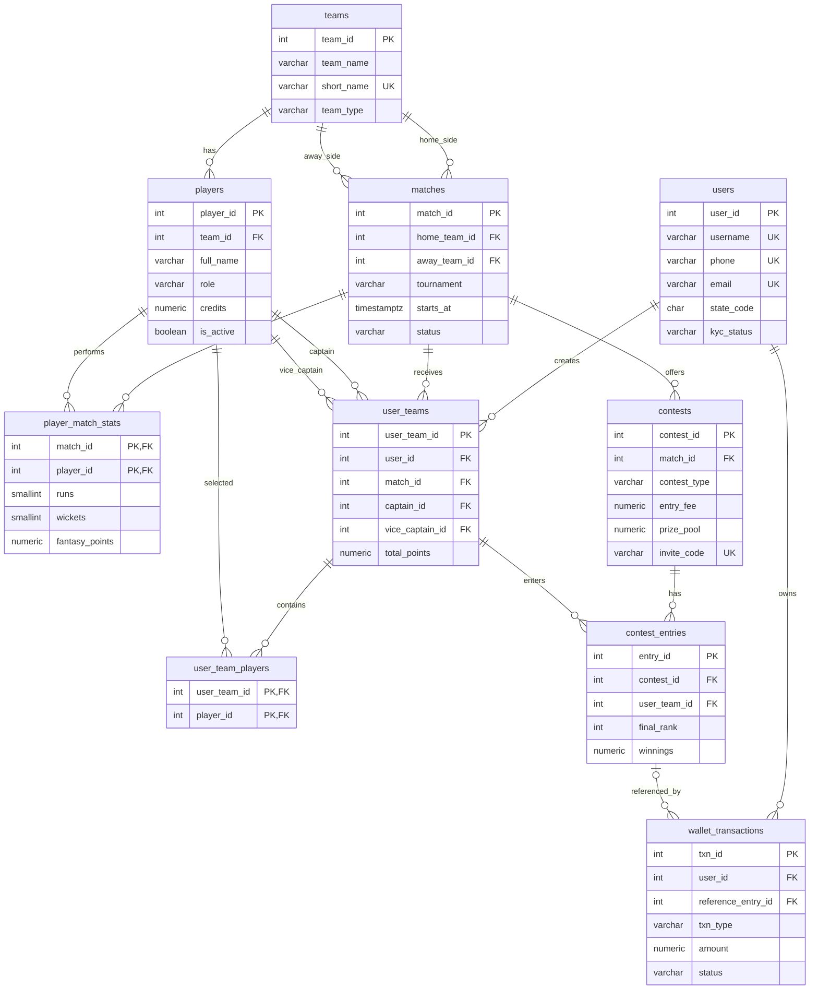

Phase 2 — Schema Design
Project: Dream11 Fantasy Sports Database
Team: AI_Web_Builder
Team No.: T0080
Section: A,B,C,E
Repository: shivamchoubey2007/DE_Project_2026
Database: PostgreSQL
Schema: dream11
1. Purpose of the design
This document explains how we have planned the relational database for the Dream11 fantasy cricket project. The design is based on the ten CSV files supplied in seed_data.zip and the operations described in the project brief.

The database needs to keep track of real cricket teams and players, match results, users, the fantasy teams they create, contests, contest entries and wallet activity. These are connected parts of the same application, but they represent different things and should not be stored together in one large table.

Our main aim is to keep the data organised, preserve relationships between records and make sure that invalid values are rejected wherever a normal table constraint can check them. At the same time, the schema should remain compatible with the fixed SQL workload supplied for the project.

The design uses ten relational tables under the PostgreSQL schema dream11. The table and column names follow the supplied CSV file names and headers so that loading the seed data does not require renaming its fields.
2. What we found in the supplied data
Before deciding the column types and constraints, we inspected the CSV headers, record counts, data types and missing values.
CSV file	Records	Columns	Main purpose
teams.csv	18	4	IPL franchises and international teams
players.csv	450	6	Player details, team, role and credits
matches.csv	212	7	Fixtures, venue, start time and status
player_match_stats.csv	4,444	9	Player performance in individual matches
users.csv	50,000	7	User profile and KYC information
user_teams.csv	39,975	8	Fantasy teams created by users
user_team_players.csv	439,925	2	Players selected in each fantasy team
contests.csv	2,544	9	Contest rules, fee, spots and prize pool
contest_entries.csv	42,746	6	Fantasy teams entered into contests
wallet_transactions.csv	118,343	7	Deposits, entry fees, winnings and other wallet activity
Total	698,657		

A few observations from the files influenced the design:
- users.email is missing for 19,935 users. It therefore needs to be nullable; making it mandatory would prevent valid seed rows from loading.
- user_teams.total_points is missing for 2,098 rows. A fantasy team's final points may not be available before a match is completed.
- contest_entries.final_rank is missing for 2,125 rows. These entries can represent contests that have not been settled yet.
- contests.invite_code is missing for 2,120 rows. Public contests do not need a private invitation code.
- wallet_transactions.reference_entry_id is missing for 63,000 rows. Deposits, withdrawals and bonuses do not necessarily belong to a contest entry.
- The starts_at, created_at and joined_at fields contain timezone offsets such as +05:30. We should preserve those offsets using TIMESTAMPTZ.
- Phone numbers are identifiers, not quantities. They should be stored as character data even though the CSV parser may interpret them as numbers.
These are intentional parts of the supplied data, not values that should automatically be replaced with defaults.
3. Tables and their responsibilities
The database is divided into the following ten tables.
Table	Responsibility
teams	Keeps the real cricket team or national side details.
players	Stores each player's profile, real team, playing role, credits and active status.
matches	Stores each fixture and the two teams taking part.
player_match_stats	Stores a player's performance for a particular match.
users	Stores registered Dream11 users and their account/KYC details.
user_teams	Stores the fantasy team created by a user for a match, including captain and vice-captain.
user_team_players	Connects a fantasy team with the players selected in it.
contests	Stores contests available for a match.
contest_entries	Records which fantasy team has joined which contest and its result.
wallet_transactions	Stores wallet activity for each user and, where applicable, its related contest entry.

Separating these responsibilities avoids repeating user, player, match and contest details in every transaction or selection record.
4. Data types and column-level design
The following data dictionary describes the proposed PostgreSQL columns and the reason for their types and constraints. PK means primary key, FK means foreign key, and UQ means unique.
4.1 teams
Stores the cricket teams referenced by players and matches.
Column	PostgreSQL type	Constraints	Reason
team_id	INTEGER	PK, NOT NULL	Stable identifier supplied in the CSV.
team_name	VARCHAR(60)	NOT NULL	Full display name of the team.
short_name	VARCHAR(4)	NOT NULL, UQ	Short code used to identify a team.
team_type	VARCHAR(20)	NOT NULL, CHECK	Distinguishes a franchise from an international side.

Suggested domain check: team_type IN ('FRANCHISE', 'INTERNATIONAL'). The short code should contain 2–4 uppercase letters.
4.2 players
Stores player details. A player belongs to one real cricket team, while a team can have many players.
Column	PostgreSQL type	Constraints	Reason
player_id	INTEGER	PK, NOT NULL	Unique player identifier.
full_name	VARCHAR(60)	NOT NULL	Player's display name.
team_id	INTEGER	FK → teams.team_id, NOT NULL	Identifies the player's real team.
role	VARCHAR(4)	NOT NULL, CHECK	Fantasy role: wicketkeeper, batter, all-rounder or bowler.
credits	NUMERIC(4,1)	NOT NULL, CHECK	Player selection cost; one decimal place is sufficient for the supplied values.
is_active	BOOLEAN	NOT NULL	Indicates whether the player is currently selectable.

The allowed roles are WK, BAT, AR and BOWL. Credits must be greater than zero. full_name is not a suitable unique key because different player records can have the same name.
4.3 matches
Stores each cricket fixture and its participating teams.
Column	PostgreSQL type	Constraints	Reason
match_id	INTEGER	PK, NOT NULL	Unique match identifier.
tournament	VARCHAR(40)	NOT NULL	Tournament or series name.
home_team_id	INTEGER	FK → teams.team_id, NOT NULL	First participating team.
away_team_id	INTEGER	FK → teams.team_id, NOT NULL	Second participating team.
venue	VARCHAR(80)	NOT NULL	Match venue as provided in the export.
starts_at	TIMESTAMPTZ	NOT NULL	Scheduled start time, including timezone.
status	VARCHAR(10)	NOT NULL, CHECK	Current match state.

Allowed statuses are UPCOMING, LIVE, COMPLETED and ABANDONED. A row-level check should also ensure that home_team_id <> away_team_id.
4.4 player_match_stats
Stores the performance of one player in one match. The pair (match_id, player_id) identifies a record.
Column	PostgreSQL type	Constraints	Reason
match_id	INTEGER	PK part, FK → matches.match_id, NOT NULL	Match in which the performance occurred.
player_id	INTEGER	PK part, FK → players.player_id, NOT NULL	Player whose performance is recorded.
runs	SMALLINT	NOT NULL, CHECK >= 0	Runs scored.
balls_faced	SMALLINT	NOT NULL, CHECK >= 0	Balls faced.
fours	SMALLINT	NOT NULL, CHECK >= 0	Number of fours.
sixes	SMALLINT	NOT NULL, CHECK >= 0	Number of sixes.
wickets	SMALLINT	NOT NULL, CHECK BETWEEN 0 AND 10	Wickets taken.
catches	SMALLINT	NOT NULL, CHECK >= 0	Catches taken.
fantasy_points	NUMERIC(6,1)	NOT NULL, CHECK >= 0	Fantasy points awarded for the performance.

A composite primary key prevents duplicate performance rows for the same player and match. Additional row-level checks can ensure fours <= balls_faced and fours * 4 + sixes * 6 <= runs.
4.5 users
Stores registered user information and account verification status.
Column	PostgreSQL type	Constraints	Reason
user_id	INTEGER	PK, NOT NULL	Unique user identifier.
username	VARCHAR(25)	NOT NULL, UQ	Login/display handle.
phone	VARCHAR(10)	NOT NULL, UQ	Contact number; character type preserves identifier formatting.
email	VARCHAR(80)	UQ, NULL allowed	Optional email address.
state_code	CHAR(2)	NOT NULL, CHECK	Two-letter state code used for regional filtering.
kyc_status	VARCHAR(10)	NOT NULL, CHECK	User verification status.
created_at	TIMESTAMPTZ	NOT NULL	Account creation time.

Allowed KYC values are PENDING, VERIFIED and REJECTED. The username and phone should be unique. Email should be unique when supplied, while allowing multiple users to have a NULL email.
4.6 user_teams
Stores a fantasy team created by a user for a particular match.
Column	PostgreSQL type	Constraints	Reason
user_team_id	INTEGER	PK, NOT NULL	Unique fantasy team identifier.
user_id	INTEGER	FK → users.user_id, NOT NULL	User who created the team.
match_id	INTEGER	FK → matches.match_id, NOT NULL	Match for which the team was created.
team_label	VARCHAR(3)	NOT NULL, CHECK	User-facing label such as T1, T2 or T3.
captain_id	INTEGER	FK → players.player_id, NOT NULL	Player selected as captain.
vice_captain_id	INTEGER	FK → players.player_id, NOT NULL	Player selected as vice-captain.
total_points	NUMERIC(6,1)	NULL allowed, CHECK >= 0 when present	Settled fantasy score; it may not be available yet.
created_at	TIMESTAMPTZ	NOT NULL	Time at which the fantasy team was saved.

The combination (user_id, match_id, team_label) should be unique so that a user cannot have two teams with the same label for the same match. Captain and vice-captain must be different players.
4.7 user_team_players
This is the junction table between user_teams and players. It records the players selected in each fantasy team.
Column	PostgreSQL type	Constraints	Reason
user_team_id	INTEGER	PK part, FK → user_teams.user_team_id, NOT NULL	Fantasy team being filled.
player_id	INTEGER	PK part, FK → players.player_id, NOT NULL	Selected player.

The composite primary key (user_team_id, player_id) prevents the same player from appearing twice in one fantasy team. This table contains only the two foreign keys because no additional attribute is present in the supplied CSV.
4.8 contests
Stores the contests offered for a match.
Column	PostgreSQL type	Constraints	Reason
contest_id	INTEGER	PK, NOT NULL	Unique contest identifier.
match_id	INTEGER	FK → matches.match_id, NOT NULL	Match to which the contest belongs.
contest_name	VARCHAR(40)	NOT NULL	Contest display name.
contest_type	VARCHAR(15)	NOT NULL, CHECK	Contest category.
entry_fee	NUMERIC(10,2)	NOT NULL, CHECK >= 0	Amount required to enter.
total_spots	INTEGER	NOT NULL, CHECK > 0	Maximum number of entries.
prize_pool	NUMERIC(12,2)	NOT NULL, CHECK >= 0	Advertised total prize pool.
is_guaranteed	BOOLEAN	NOT NULL	Indicates whether the prize pool is guaranteed.
invite_code	VARCHAR(8)	UQ, NULL allowed	Code used to join a private contest.

Allowed contest types are MEGA, SMALL, HEAD_TO_HEAD and PRIVATE. A private contest should have an invite code, while a public contest should not. A head-to-head contest has two spots in the supplied data. The prize pool should not be calculated as entry_fee * total_spots; it is stored as its own business value.
4.9 contest_entries
Records the entry of a fantasy team into a contest.
Column	PostgreSQL type	Constraints	Reason
entry_id	INTEGER	PK, NOT NULL	Unique contest-entry identifier.
contest_id	INTEGER	FK → contests.contest_id, NOT NULL	Contest joined.
user_team_id	INTEGER	FK → user_teams.user_team_id, NOT NULL	Fantasy team entered.
joined_at	TIMESTAMPTZ	NOT NULL	Time of joining.
final_rank	INTEGER	NULL allowed, CHECK > 0 when present	Final position after settlement.
winnings	NUMERIC(10,2)	NOT NULL, DEFAULT 0, CHECK >= 0	Amount won by the entry.

The pair (contest_id, user_team_id) should be unique. This also supports the fixed workload's conflict-handling operation on that pair. final_rank can remain NULL until the contest is settled; an unsettled entry should not show winnings.
4.10 wallet_transactions
Stores the wallet ledger for each user.
Column	PostgreSQL type	Constraints	Reason
txn_id	INTEGER	PK, NOT NULL	Unique transaction identifier.
user_id	INTEGER	FK → users.user_id, NOT NULL	User whose wallet is affected.
txn_type	VARCHAR(12)	NOT NULL, CHECK	Type of wallet activity.
amount	NUMERIC(10,2)	NOT NULL, CHECK > 0	Transaction amount.
reference_entry_id	INTEGER	FK → contest_entries.entry_id, NULL allowed	Related contest entry, when applicable.
status	VARCHAR(10)	NOT NULL, CHECK	Transaction processing status.
created_at	TIMESTAMPTZ	NOT NULL	Transaction timestamp.

Allowed transaction types are DEPOSIT, WITHDRAWAL, ENTRY_FEE, WINNINGS, REFUND and BONUS. Allowed statuses are SUCCESS, PENDING and FAILED. Entry-related transaction types use reference_entry_id; deposits, withdrawals and bonuses can leave it NULL.
5. Keys and relationships
Primary keys identify rows. Foreign keys connect the tables and prevent references to records that do not exist.
Child table and column	Referenced table and column	Relationship
players.team_id	teams.team_id	One team can have many players.
matches.home_team_id	teams.team_id	A team can be the home side in many matches.
matches.away_team_id	teams.team_id	A team can be the away side in many matches.
player_match_stats.match_id	matches.match_id	A match can have many player-stat rows.
player_match_stats.player_id	players.player_id	A player can have stats in many matches.
user_teams.user_id	users.user_id	A user can create many fantasy teams.
user_teams.match_id	matches.match_id	A match can have many fantasy teams.
user_teams.captain_id	players.player_id	Each fantasy team has a captain.
user_teams.vice_captain_id	players.player_id	Each fantasy team has a vice-captain.
user_team_players.user_team_id	user_teams.user_team_id	A fantasy team has multiple selected players.
user_team_players.player_id	players.player_id	A player can be selected in many fantasy teams.
contests.match_id	matches.match_id	A match can offer many contests.
contest_entries.contest_id	contests.contest_id	A contest can receive many entries.
contest_entries.user_team_id	user_teams.user_team_id	A fantasy team can enter contests.
wallet_transactions.user_id	users.user_id	A user can have many wallet transactions.
wallet_transactions.reference_entry_id	contest_entries.entry_id	An entry-related transaction can refer to a contest entry.

5.1 Composite keys and alternate unique keys
Three tables need composite or alternate uniqueness rules beyond their simple identifier:
- player_match_stats: (match_id, player_id) is the primary key because a player should have one stats record per match.
- user_team_players: (user_team_id, player_id) is the primary key because a player should not be selected twice in the same fantasy team.
- user_teams: (user_id, match_id, team_label) is an alternate unique key because team labels are local to a user's teams for a match.
- contest_entries: (contest_id, user_team_id) is an alternate unique key so the same fantasy team cannot be entered twice in one contest.
teams.short_name, users.username, users.phone and the non-NULL values of users.email are also unique.
6. Integrity rules and CHECK constraints
Constraints are used to catch invalid values close to where they are inserted. The following rules are suitable for table-level or column-level constraints.
No.	Table	Rule
1	teams	short_name must contain 2–4 uppercase letters.
2	teams	team_type must be FRANCHISE or INTERNATIONAL.
3	players	role must be one of WK, BAT, AR, BOWL.
4	players	credits must be greater than zero.
5	matches	Home and away teams must be different.
6	matches	status must be one of the four supplied match statuses.
7	player_match_stats	Runs, balls, fours, sixes, catches and fantasy points cannot be negative.
8	player_match_stats	Wickets must be between 0 and 10.
9	player_match_stats	Fours cannot exceed balls faced.
10	player_match_stats	Runs from fours and sixes cannot exceed total runs.
11	users	Username must follow the accepted username format.
12	users	Phone must contain a valid 10-digit Indian mobile number format.
13	users	A non-NULL email must have a basic email-address format.
14	users	state_code must contain two uppercase letters.
15	users	kyc_status must be PENDING, VERIFIED or REJECTED.
16	user_teams	Captain and vice-captain must be different players.
17	user_teams	team_label must be one of the labels present in the export (T1–`T3`).
18	user_teams	If total_points is present, it cannot be negative.
19	contests	contest_type must be one of the four supported types.
20	contests	Entry fee and prize pool cannot be negative.
21	contests	Total spots must be greater than zero.
22	contests	Private contests must have an invite code; non-private contests must not.
23	contests	A non-NULL invite code must contain eight uppercase letters or digits.
24	contests	A head-to-head contest must have exactly two spots.
25	contest_entries	A non-NULL final rank must be greater than zero.
26	contest_entries	Winnings cannot be negative.
27	contest_entries	If final rank is NULL, winnings must be zero.
28	wallet_transactions	Transaction type must be one of the six supported types.
29	wallet_transactions	Amount must be greater than zero.
30	wallet_transactions	Status must be SUCCESS, PENDING or FAILED.
31	wallet_transactions	An entry reference is required for ENTRY_FEE, WINNINGS and REFUND, and not required for the other types.

The final SQL implementation should use the exact values observed in the seed files. A constraint should be checked against the complete CSV data before it is treated as final.
7. NULL values and why they are allowed
NULL does not always mean bad data. In this project, some fields are not applicable to every row or are not known until a later stage of the application's workflow.
Table.column	Missing rows in CSV	Reason for allowing NULL
users.email	19,935	Email is optional in the supplied user records.
user_teams.total_points	2,098	Points may not have been finalised for the match.
contests.invite_code	2,120	Public contests do not need an invitation code.
contest_entries.final_rank	2,125	The contest result may not have been settled.
wallet_transactions.reference_entry_id	63,000	Not every wallet transaction is linked to a contest entry.

The other columns in the supplied CSV files have no missing values and can be declared NOT NULL, subject to the final load test.
8. Normalization
The tables are separated according to the entities and relationships in the application. This reduces repeated data and makes updates more reliable.
First Normal Form (1NF)
Each column stores a single value rather than a list of values. For example, the players selected in a fantasy team are not stored as a comma-separated list inside user_teams. They are stored as separate rows in user_team_players.
Second Normal Form (2NF)
A table must be in 1NF, and every non-key attribute must depend on the whole candidate key. In player_match_stats, performance values depend on both match_id and player_id, not on only one part of the composite key. user_team_players contains only its two key columns, so there are no partial dependencies.
Third Normal Form (3NF)
Non-key attributes should depend on the key, the whole key and nothing but the key. Team names are kept in teams, rather than being repeated in every player or match record. User profile information is kept in users, rather than copied into contest entries and wallet transactions. Contest details are kept in contests, while individual participation is stored in contest_entries.

The design therefore follows 3NF principles. The two junction tables (player_match_stats and user_team_players) use composite keys where the relationship itself identifies a row.
9. Business rules that need more than a CHECK constraint
Some important fantasy-cricket rules involve multiple rows or multiple tables. A normal PostgreSQL CHECK constraint cannot safely count related rows or inspect another table.

Examples:
- A fantasy team should contain exactly 11 distinct players.
- The sum of selected-player credits should stay within the permitted budget.
- A team should not select more than the allowed number of players from one real side.
- The captain and vice-captain should be members of that fantasy team's selected XI.
- Selected players should belong to one of the two teams playing that match.
- Contest entries should not exceed the contest's available spots.
- A paid contest entry should have the corresponding wallet debit, and an abandoned match may require a refund.
These rules should be checked using validation queries, application logic or carefully designed triggers where required. They should not be represented as ordinary row-level CHECK constraints when the rule depends on other rows.
10. ER diagram
The following diagram shows the main relationships between the ten tables. The two links from matches to teams represent the home and away sides. The two links from user_teams to players represent captain and vice-captain.

11. Delete behaviour
Delete rules should protect records that are needed for historical or financial reporting.
Relationship	Suggested action	Reason
players → teams	RESTRICT	A team should not be removed while players refer to it.
matches → teams	RESTRICT	Historical fixtures must retain their participating teams.
player_match_stats → matches	CASCADE	Match statistics belong to the match record.
player_match_stats → players	RESTRICT	Player performance history should be retained.
user_teams → users	RESTRICT	User-created fantasy teams are historical records.
user_teams → matches	RESTRICT	A match with fantasy teams should not be deleted.
user_team_players → user_teams	CASCADE	Selected-player rows have no meaning without their fantasy team.
user_team_players → players	RESTRICT	A player referenced by a saved team should be retained.
contests → matches	RESTRICT	Contest history belongs to a match.
contest_entries → contests	RESTRICT	Entry history should not disappear with a contest.
contest_entries → user_teams	RESTRICT	Entries refer to saved fantasy teams.
wallet_transactions → users	RESTRICT	Wallet history must be retained.
wallet_transactions → contest_entries	RESTRICT	Financial references should not become orphaned.

The general approach is to allow cascading only for dependent composition records. User, match, contest and wallet history should be protected.
12. Indexing approach for the next phase
For this phase, primary keys and unique constraints provide the indexes PostgreSQL needs to enforce uniqueness. We are not adding workload-specific indexes in the initial schema.

This is intentional. The next phase measures the supplied query workload before optimisation. Adding indexes now would make it difficult to compare the baseline with the optimised version fairly. Foreign-key columns can be considered for additional indexes after the baseline timings and query plans have been collected.
13. Loading order and verification plan
The CSVs should be loaded in parent-to-child order so that foreign-key checks succeed.
1. teams
2. players
3. matches
4. users
5. player_match_stats
6. user_teams
7. user_team_players
8. contests
9. contest_entries
10. wallet_transactions
After loading, we should verify:
- The row count of every table against the counts in Section 2.
- That all primary keys are unique and non-NULL.
- That foreign-key references resolve, except for the intentionally nullable wallet entry reference.
- That the expected NULL counts in Section 7 have not changed.
- That all CHECK and UNIQUE constraints accept the supplied records.
- That the fixed workload can run without changing its SQL statements.
Useful starting commands from the repository root:
createdb dream11
psql -d dream11 -f sql/01_schema.sql
psql -d dream11 -f sql/02_load_data.sql
The database and load scripts should be tested on a clean database before the team marks this phase complete. The row counts above are the expected counts from the supplied CSV files; they should only be described as successfully loaded after the PostgreSQL load and verification commands have actually passed.
14. Design decisions to keep in mind
1. Use NUMERIC for money and fantasy points. Floating-point types can introduce rounding differences in financial values.
2. Use TIMESTAMPTZ for timestamps. The CSV values include timezone offsets, which should not be discarded.
3. Keep optional fields nullable. The missing email, score, rank, invite code and wallet reference values have meaning in the supplied data.
4. Do not make names unique without evidence. Player names and display names are not reliable identifiers; use the supplied IDs.
5. Do not store a fantasy XI in one text column. The junction table makes selections queryable and prevents duplicate player selections within one team.
6. Do not add tuning indexes before the baseline. Measure first, then optimise in the appropriate phase.
7. Do not silently repair seed data. If a business rule is violated by a row, report it and investigate it instead of changing the supplied CSV.
Prepared by: AI_Web_Builder
Team No.: T0080
